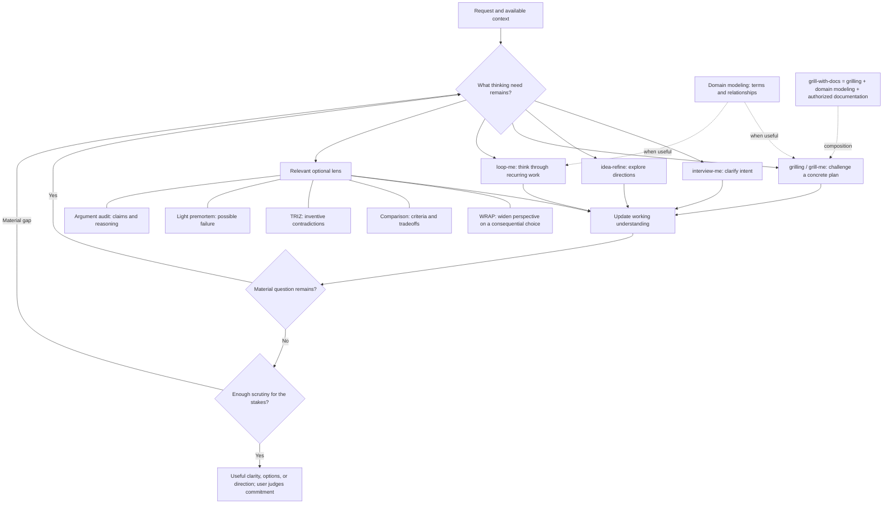

# Thought Partner

One install for thinking through coding projects, knowledge-work plans, writing ideas, choices, and recurring activities. Start with what you have. The router picks the useful method, changes course as needed, and stops when you have useful clarity.

## Install

Ask your skill-aware agent to install **thought-partner** from **nateprich/ai-workbench**, including the whole folder. Or use the [skills CLI](https://github.com/vercel-labs/skills):

```text
npx skills add nateprich/ai-workbench --skill thought-partner
```

The CLI requires a supported Node.js version and lets you choose a supported agent. Repository installs require access to this GitHub repository. For a manual or ZIP install, copy the entire `thought-partner/` folder into your tool's skills directory. Keep `references/`, `licenses/`, `LICENSE`, and `PROVENANCE.md` with `SKILL.md`. There are no upstream skills, Python packages, MCP servers, or paid external review services to install.

## Use it

Invoke `thought-partner`, or ask for help thinking something through. Examples:

- “I want to build a dashboard, but I'm not sure what problem it should solve.”
- “Help me find an angle for an article about AI and editing.”
- “Grill me on this plan. Here are the goal, constraints, and decisions I've made.”
- “Help me rethink my weekly reporting routine.”
- “Compare these directions” or “check whether this argument holds.”

Ordinary “interview me” and “grill me” wording goes through the router. Explicitly choosing the **interview-me method**, **idea-refine**, **grill-me**, or another internal method selects the initial approach. These are internal methods, not additional slash commands installed by this pack. The host controls automatic discovery; other installed skills with overlapping triggers can still compete.

## The flow



There is no required progression through all the methods. Domain modeling can support any discussion with ambiguous domain language. Research happens when relevant facts would change the thinking. Independent review uses the existing challenge lenses where supported and authorized; scrutiny already done counts. Every iteration must address a material question or new evidence. An open question can be a useful stopping point.

Work stays in chat unless saving is requested or already authorized. A workflow discussion need not become a spec or automation. If you have already asked for subsequent drafting or implementation, the assistant can continue that authorized work after the thinking portion.

## What is bundled

The [entrypoint](SKILL.md) provides a shared interaction contract and loads only the useful method reference. Core methods are adapted from Addy Osmani's and Matt Pocock's original repositories. Optional lenses include adaptations from neurofoo, Claudio Babelis/radarist, Vladimir Kochetkov/v0lka, and sammcj, plus an original short description of Gary Klein's premortem method. Full pinned sources, licenses, and deliberate changes are in [PROVENANCE.md](PROVENANCE.md).

These are scoped adaptations, not unmodified upstream skills or complete MCDA/TRIZ software. This pack works conversationally without web, connectors, subagents, or a repository; evidence and independent review depend on the capabilities actually available.

## Upgrading and retiring old copies

Replace the previous owned router folder with this complete folder. The older folder was `interview/` and the older skill name was `interview-first`; the intermediate rename used `thought-partner/` with only `SKILL.md` and `README.md`. Back up local customizations outside every active skill-discovery directory, install the new complete folder, then remove only superseded copies of your router so one `thought-partner` entrypoint remains. A host may require a new session or catalog refresh.

The Saul Martí **engineering-suite-grill-me** bundle is unnecessary for this pack. If it was installed only to provide these methods, remove it through your host's plugin manager after checking the replacement is available. Independently installed original skills may be kept for direct use; they are not dependencies, and their own triggers remain under the host's control. This pack does not uninstall plugins or alter other skills automatically.
